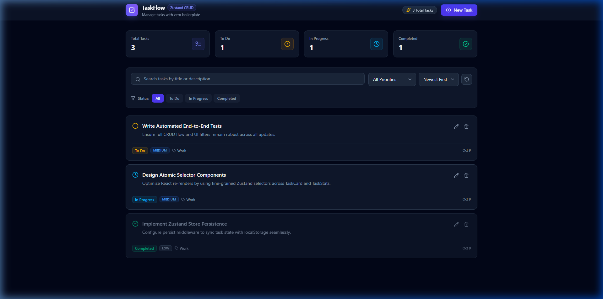

# ⚡ TaskFlow — Zustand CRUD Application

**TaskFlow** is a modern, high-performance task management application built with **React 19**, **TypeScript**, **Zustand 5**, and **Tailwind CSS v4**.

It serves as a clean, practical blueprint for mastering state management in the modern React ecosystem—demonstrating how to achieve full CRUD capabilities, real-time filtering, metric calculations, and local persistence with **zero boilerplate** and **fine-grained re-render optimization**.



---

## 🎯 Purpose of TaskFlow

In modern frontend architecture, developers often face trade-offs when choosing a state management tool:

* **React Context API**: Easy to set up, but every consumer re-renders whenever any context property updates, making it inefficient for frequent updates and larger state trees.
* **Redux Toolkit**: Highly scalable, but requires substantial boilerplate (actions, reducers, slices, dispatchers, wrappers).
* **Zustand**: Provides the best of both worlds. It operates outside the React component tree (no `<Provider>` required), offers native `async/await` support, automatically synchronizes with storage, and enables atomic subscriptions that eliminate unwanted re-renders.

### Key Learning & Architectural Goals
1. **Master Zustand Store Architecture**: Implement centralized state, actions, and selectors in a single cohesive store (`useTaskStore.ts`).
2. **Eliminate Re-render Overhead**: Use atomic selectors (`useTaskStore(state => state.tasks)`) rather than blanket destructuring to keep rendering surgical and fast.
3. **Data Persistence**: Persist task data seamlessly across page reloads using Zustand's `persist` middleware while keeping transient UI state (search queries, modal states) memory-only via `partialize`.
4. **Clean Domain Modeling**: Maintain strict TypeScript typing across tasks, statuses, priorities, and filters.
5. **Modern Design System**: Showcase modern styling patterns using Tailwind CSS v4 and Lucide icons without legacy PostCSS or configuration overhead.

---

## ✨ Features

- **Full Task Lifecycle (CRUD)**:
  - **Create**: Add tasks with title, description, category, and priority.
  - **Read**: View tasks in responsive cards with visual priority, status, and category tags.
  - **Update**: Edit existing tasks in place via modal or cycle statuses (`To Do` ➔ `In Progress` ➔ `Completed`) with a single click.
  - **Delete**: Remove tasks instantly with immediate state and statistics recalculation.
- **Real-Time Analytics Dashboard**: Live counters for *Total Tasks*, *To Do*, *In Progress*, and *Completed*.
- **Search, Filter & Sort**:
  - Live fuzzy search across titles, descriptions, and categories.
  - Filter by Status (`All`, `To Do`, `In Progress`, `Completed`).
  - Filter by Priority (`Low`, `Medium`, `High`).
  - Sort by *Newest*, *Oldest*, or *Priority level*.
  - One-click filter reset button.
- **LocalStorage Persistence**: Task items automatically save to browser storage and reload upon refresh.
- **Polished UX/UI**: Dark-mode aesthetic, custom styled select inputs, modal animations, and responsive layout.

---

## 🛠️ Tech Stack

| Technology | Purpose |
| :--- | :--- |
| **React 19** | Component-based UI library |
| **TypeScript** | Strict type safety and domain models |
| **Zustand 5** | Lightweight, boilerplate-free state management |
| **Tailwind CSS v4** | Modern utility-first CSS styling via `@tailwindcss/vite` |
| **Vite 8** | Next-generation build tool and dev server |
| **Lucide React** | Clean, consistent icons |

---

## 📁 Project Structure

```text
zustand-project/
├── public/                 # Static assets
├── src/
│   ├── components/         # Modular UI components
│   │   ├── Navbar.tsx      # Header & global task creation trigger
│   │   ├── TaskCard.tsx    # Individual task card with status toggle & actions
│   │   ├── TaskFilters.tsx # Search bar, filter pills, dropdowns & reset
│   │   ├── TaskList.tsx    # Filtered & sorted task list rendering
│   │   ├── TaskModal.tsx   # Task creation and editing modal dialog
│   │   └── TaskStats.tsx   # Real-time task statistics dashboard
│   ├── store/
│   │   └── useTaskStore.ts # Central Zustand store (state, actions, persist)
│   ├── types/
│   │   └── task.ts         # TypeScript models, union types & filters
│   ├── App.tsx             # Main application layout (No Provider needed!)
│   ├── index.css           # Tailwind CSS v4 import
│   └── main.tsx            # Application entry point
├── GUIDE.md                # Comprehensive hands-on step-by-step tutorial
└── package.json            # Project dependencies & scripts
```

---

## 🚀 Getting Started

### 1. Prerequisites
Ensure you have **Node.js 18+** installed on your system.

### 2. Installation
Clone or navigate to the project directory and install dependencies:

```bash
npm install
```

### 3. Development Server
Run the local Vite development server:

```bash
npm run dev
```

> **Note for Windows PowerShell**: If script execution is restricted on your system, execute npm commands using `npm.cmd` (e.g., `npm.cmd run dev`).

Open [http://localhost:5173](http://localhost:5173) in your browser to view the application.

### 4. Build for Production
Create an optimized production build:

```bash
npm run build
```

### 5. Linting
Run ESLint to check for code quality and hook rules:

```bash
npm run lint
```

---

## 💡 Zustand Core Concepts Demonstrated

### 1. Atomic Selectors (Avoid Blanket Subscriptions)
```tsx
// ❌ Avoid: Subscribes to the entire store, causing unnecessary re-renders
const { tasks, searchQuery } = useTaskStore();

// ✅ Recommended: Subscribes ONLY to specific slice
const tasks = useTaskStore((state) => state.tasks);
const addTask = useTaskStore((state) => state.addTask);
```

### 2. Immutable State Updates
```typescript
// Adding a task
addTask: (data) =>
  set((state) => ({
    tasks: [{ ...data, id: crypto.randomUUID(), createdAt: new Date().toISOString() }, ...state.tasks],
  })),

// Updating a task
updateTask: (id, updates) =>
  set((state) => ({
    tasks: state.tasks.map((task) => (task.id === id ? { ...task, ...updates } : task)),
  })),
```

### 3. Selective Persistence (`partialize`)
```typescript
persist(
  (set) => ({ /* ... */ }),
  {
    name: 'taskflow-storage',
    storage: createJSONStorage(() => localStorage),
    // Only persist tasks; UI state like modal open and search queries remain ephemeral
    partialize: (state) => ({ tasks: state.tasks }),
  }
)
```

---

## 📄 License
This project is open-source and available under the [MIT License](LICENSE).
